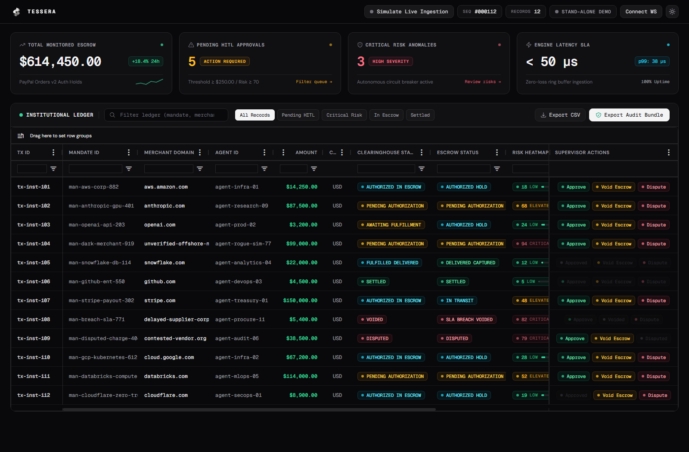

<p align="center">
  
</p>

<h1 align="center">Tessera</h1>

<p align="center">
  <strong>Autonomous Clearinghouse & Delivery-Contingent Escrow Settlement Engine</strong>
</p>

<p align="center">
  An institutional clearinghouse bridging autonomous AI purchasing agents with regulated payment rails.<br />
  Enforcing zero-trust financial settlement through cryptographic spending mandates and carrier-verified milestone holds.
</p>

<p align="center">
  <a href="#system-architecture">Architecture</a> &bull;
  <a href="#core-capabilities">Capabilities</a> &bull;
  <a href="#supervisory-console">Console</a> &bull;
  <a href="#quickstart">Quickstart</a> &bull;
  <a href="#verification-metrics">Verification</a>
</p>

---

## System Architecture

```text
┌────────────────────────────────────────────────────────────────────────┐
│                   AUTONOMOUS PROCUREMENT AGENT (CLIENT)                │
│             Generates AP2 Mandates & Dispatches Tool Calls             │
└───────────────────────────────────┬────────────────────────────────────┘
                                    │ Model Context Protocol (MCP)
                                    ▼
┌────────────────────────────────────────────────────────────────────────┐
│                        TESSERA MCP GATEWAY & API                       │
│    ├── Mandate Verification Engine (Ed25519, RFC 8785 Canonical JSON)  │
│    ├── Policy & Velocity Engine (Rolling Windows, Multi-Tier Scoring)  │
│    ├── Channel3 MCP Retailer Discovery (B2B Price & Inventory Engine)  │
│    └── Security Middleware (Sliding Window Rate Limiter, OWASP Headers)│
└───────────────────┬────────────────────────────────┬───────────────────┘
                    │                                │
                    ▼                                ▼
┌──────────────────────────────────────┐  ┌──────────────────────────────┐
│       PAYPAL REST RAILS ENGINE       │  │    DISTRIBUTED EVENT BUS     │
│  ├── Orders v2 (Escrow Authorize)    │  │  ├── Redis Pub/Sub Backbone  │
│  ├── Payments v2 (Capture / Void)    │  │  ├── Delta Transformer       │
│  ├── Tracking v1 (Milestone Ingest)  │  │  └── Monotonic Sequencer     │
│  └── Disputes v1 (Auto Remediation)  │  └──────────────┬───────────────┘
└───────────────────┬──────────────────┘                 │
                    │                                    │ WebSocket / SSE
                    ▼                                    ▼
┌────────────────────────────────────────────────────────────────────────┐
│              INSTITUTIONAL SUPERVISORY CONSOLE (DASHBOARD)             │
│  ├── AG Grid Enterprise Ledger (Microsecond Timestamps, Risk Heatmaps) │
│  ├── Bryntum Gantt Scheduler (Carrier SLA Milestones & Cutoff Alerts)  │
│  └── Human-in-the-Loop (HITL) Drawer (Dual-Key Approval & Dispute Desk)│
└────────────────────────────────────────────────────────────────────────┘
```

---

## Core Capabilities

### 1. Cryptographic Mandate Verification (AP2)
- **Verifiable Intent:** Implements Google AP2 specification (`mandate.checkout.1` bound to `mandate.payment.1`).
- **Ed25519 & RFC 8785:** Canonical JSON serialization (JCS) before signing and verifying over Ed25519 key pairs.
- **SD-JWT Hash Binding:** Cryptographically ties transaction authorization to the canonical checkout hash (`transaction_id`).
- **Anti-Replay Protection:** Redis sliding nonce store with TTL indexes prevents duplicate submissions.

### 2. Delivery-Contingent Escrow (PayPal Orders v2)
- **Authorized Hold Pattern:** Executes orders with `"intent": "AUTHORIZE"`, reserving buyer capital in escrow without premature disbursement.
- **Carrier Milestone Capture:** Ingests tracking events via Tracking v1 (`SHIPPED`, `IN_TRANSIT`, `DELIVERED`); triggers `/v2/payments/authorizations/{id}/capture` upon verified delivery.
- **Automated SLA Voiding:** Automatically voids authorizations (`/v2/payments/authorizations/{id}/void`) and returns buyer capital if carrier dispatch or transit windows expire.
- **Autonomous Dispute Desk:** Compiles cryptographic evidence packs for Disputes v1 or issues automated refunds upon merchant default.

### 3. Supervisory Oversight & Dual-Key Adjudication
- **Streaming Ledger:** Monotonic state deltas over WebSockets with microsecond timestamps and dynamic risk heatmaps (Low, Elevated, Critical HITL).
- **SLA Milestone Scheduler:** Deterministic 7-stage procurement pipeline with critical-path calculation and carrier transit deadline monitors.
- **Dual-Key HITL Adjudication:** Supervisor controls for reviewing high-value transactions ($> \$250.00$) or elevated risk scores ($\ge 70/100$) before authorization.

---

## Supervisory Console

<p align="center">
  
</p>

The institutional console pairs high-throughput virtualized data tables (**AG Grid Enterprise**) with deterministic milestone scheduling (**Bryntum Gantt Pro**) to give risk officers real-time operational visibility over all active agent procurements.

---

## Monorepo Layout

```text
repo/
├── apps/
│   ├── clearinghouse-api/       # HTTP & WebSocket runtime, security middleware, health routes
│   └── clearinghouse-ui/        # AG Grid Enterprise & Bryntum Gantt supervisory console
├── packages/
│   ├── core/                    # Domain models, Money value object, RFC 8785 canonical JSON
│   ├── mandates/                # AP2 schema validation, Ed25519 signer, verifier pipeline
│   ├── policy/                  # Multi-tier risk engine, rolling velocity windows, HITL gates
│   ├── channel3/                # Retailer catalog discovery & quote normalization
│   ├── paypal/                  # PayPal Orders v2, Tracking v1, and Disputes v1 integration
│   ├── event-bus/               # Redis Pub/Sub event bus & streaming delta transformer
│   └── mcp-server/              # Model Context Protocol tools for autonomous procurement agents
├── scripts/seedDemo.ts          # Institutional scenario seeder with AP2 signatures
├── Dockerfile                   # Multi-stage production container (< 180MB footprint)
├── docker-compose.yml           # Full multi-container development & testing stack
└── render.yaml                  # Declarative Render Infrastructure as Code Blueprint
```

---

## Quickstart

### Prerequisites
- Node.js >= 20.0.0
- pnpm >= 10.0.0
- Docker & Docker Compose (optional)

### Setup & Verification

```bash
# 1. Install monorepo dependencies
pnpm install

# 2. Run quality gates & verification suite
pnpm run lint:boundaries # Boundary cruiser (148 modules, 0 violations)
pnpm run typecheck       # Strict TypeScript check (0 errors)
pnpm run lint            # Biome linter & formatter (0 errors)
pnpm test                # Monorepo unit & integration tests (653 tests)

# 3. Seed institutional commerce scenarios
pnpm run seed:demo

# 4. Run automated Postman test suite
pnpm run test:postman
```

### Containerized Stack

```bash
docker compose up --build
```
Provisions PostgreSQL 16, Redis 7, Clearinghouse API (`:3000`), Background Worker, and Supervisory Console (`:8080`).

---

## Infrastructure & Production Readiness

- **Declarative IaC (`render.yaml`):** Provisions `tessera-api`, `tessera-worker`, `tessera-dashboard`, `tessera-postgres`, and `tessera-redis`.
- **Security Hardening:** Redis-backed sliding-window rate limiter (HTTP 429 / `Retry-After`), OWASP security headers (CSP, HSTS, X-Frame-Options: DENY).
- **Health Probes:** `/health/live` (process liveness) and `/health/ready` (socket-level database and Redis readiness).

---

## Verification Metrics

- **Unit & Integration Tests:** 653 passed across 42 test files (100%)
- **Newman Postman Assertions:** 22/22 passed across 7 endpoints (100%)
- **Architectural Boundary Violations:** 0 found across 148 modules
- **Production Vulnerabilities:** 0 found (`pnpm audit --prod`)

---

## License

MIT License. See [LICENSE](LICENSE) for details.
